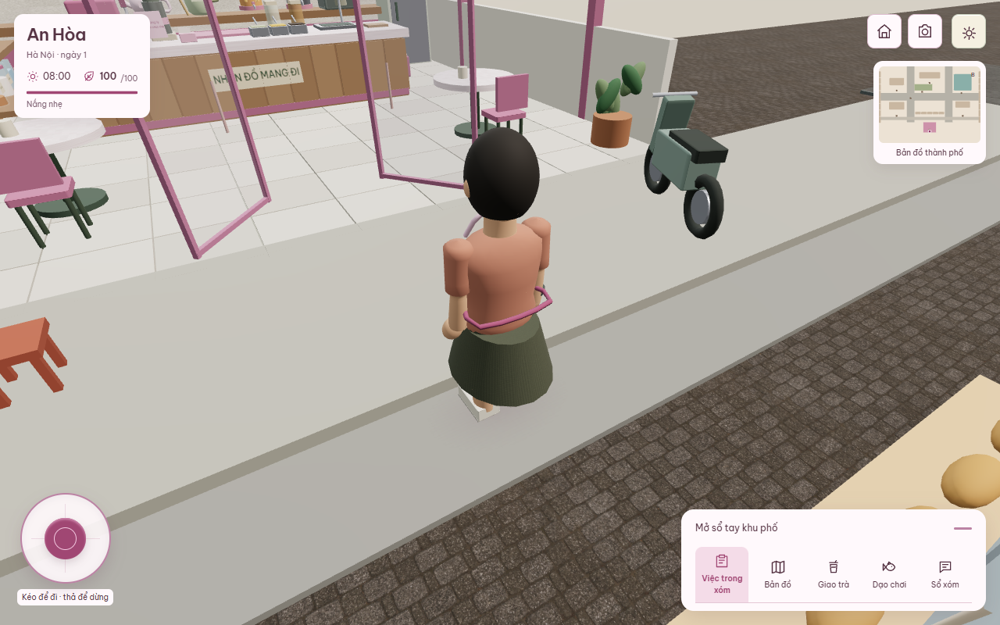
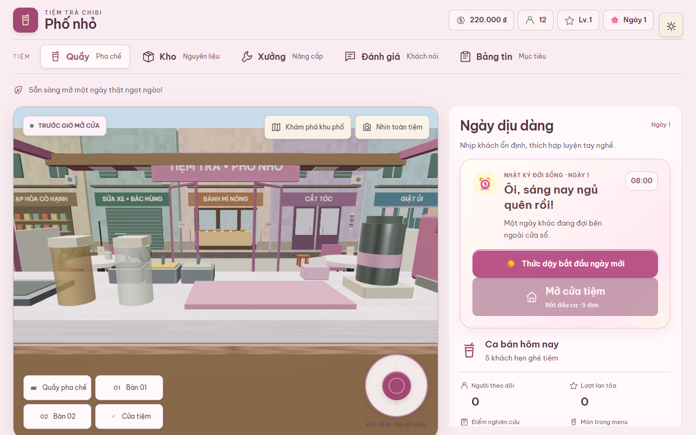

# Đồ họa và logic — 18/10/2026

Nhánh: codex/visual-logic-cohesion-20261016, nền f40d9fa.

## Đã sửa

- Tóc dùng một bề mặt ôm đầu với đường chân tóc biến thiên theo góc; giữ năm
  kiểu và búi tóc riêng. Bỏ các khối tóc mái, tóc gáy xếp chồng. 627 đỉnh mỗi
  kiểu dùng chung geometry, không tải asset bên ngoài.
- Khối kiến trúc từ 2 đơn vị dùng góc thẳng thay cho rounded box kéo giãn;
  đồ nhỏ giữ bo cạnh. Thêm bóng tiếp xúc cho khách tới quầy cả chế độ nhẹ.
- Camera giữ phản ứng thu vào ngay trước tường, phục hồi khoảng cách từ từ
  sau vật cản, theo delta time; reduced motion giữ camera tĩnh tức thời.
- Một nhóm chợ với trái cây, rau/trứng, hỏi thăm, đi tiếp; một lựa chọn/ngày.
  Hai reducer cũ và save cũ vẫn được đọc, kể cả lựa chọn chat từ nhánh nấu ăn.
- Mua rau và nấu cơm kiểm tra đủ sức/thời gian trước khi trừ tiền hoặc phát
  thưởng; mua trái cây cũng không thể dùng clamp 21:00 để thực hiện miễn phí
  thời gian. UI dùng cùng điều kiện với reducer, hiển thị lý do bị khóa.
- Nút mở tiệm nằm ngay sau bữa sáng, trước các cuộc gọi tùy chọn, chỉ một nút.

## Bằng chứng

- npm test: 647 test / 133 file Vitest, 6/6 node acceptance, life design validator.
- npm run build: thành công; vẫn cảnh báo bundle Babylon lớn, chưa xử lý ở lượt này.
- [Chợ/nấu/reload/mở tiệm](evidence/cohesion-20261018/market-results.json):
  bốn viewport 360×800, 390×844, 844×390, 1280×800; không pageerror.
- [Ảnh scene thực](evidence/cohesion-20261018/visual-results.json): camera fixture,
  không phải bằng chứng tự đi bộ qua toàn bản đồ.
- Tests mới kiểm tra bảo toàn tiền/sức/thời gian/lựa chọn khi bị chặn, đường
  thưởng nấu ăn, vị trí nút mở tiệm, normal và UV seam tóc, phục hồi camera.

## Giới hạn và bước tiếp

Mô hình thân/vai, cây và xe vẫn procedural, chưa đạt chân thực. Chưa có số đo
FPS hoặc tải trên điện thoại cấu hình thấp. Chưa thay bằng nhân vật rigged
ngoài repo; không tuyên bố đã hoàn thiện art production. Lượt tiếp cần thay
một nhân vật mẫu và một đoạn mặt phố bằng asset có license, kiểm tra trực tiếp
đi bộ/ngồi/cầm ly/chào rồi mới nhân rộng. Giữ game/save hiện tại khi thay asset.
