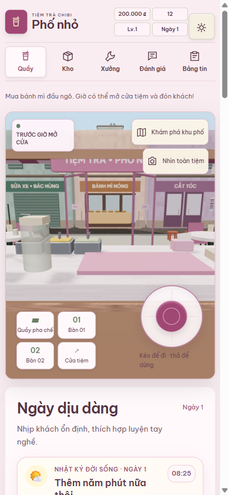
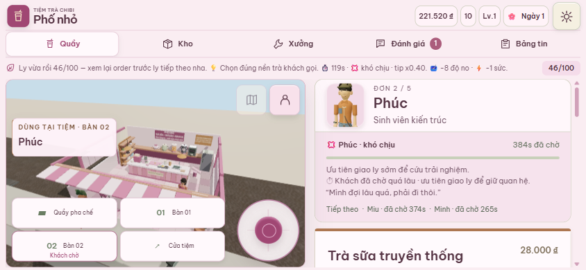
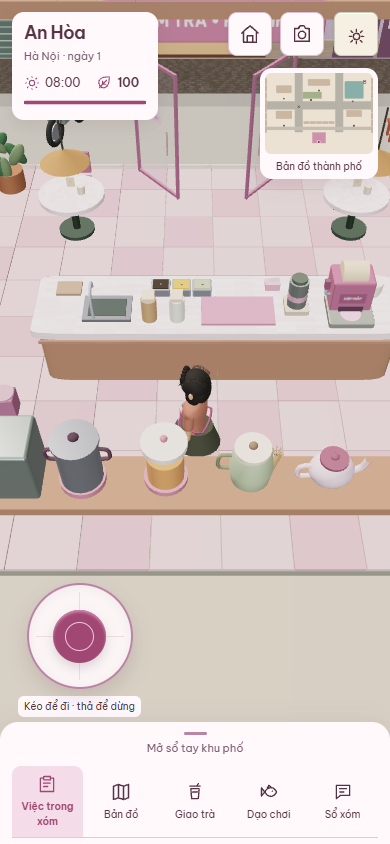
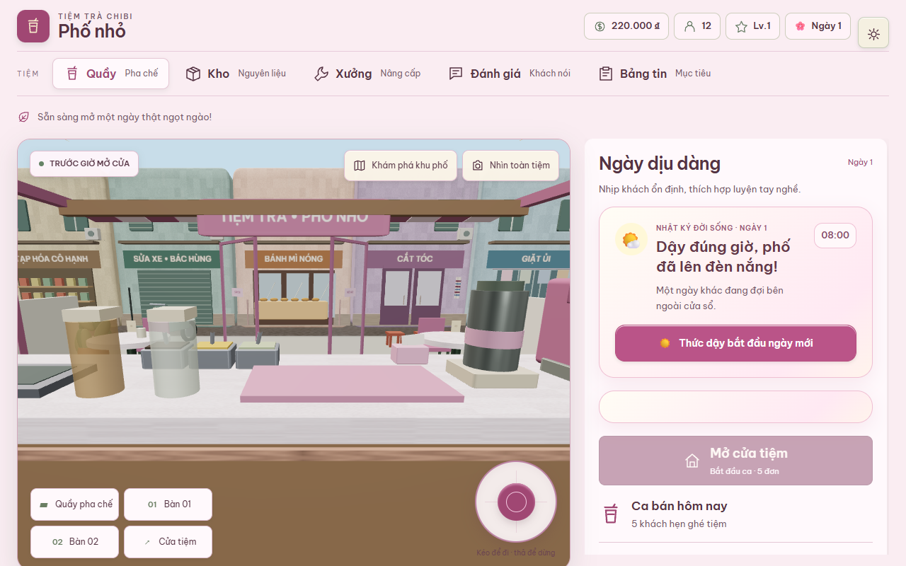
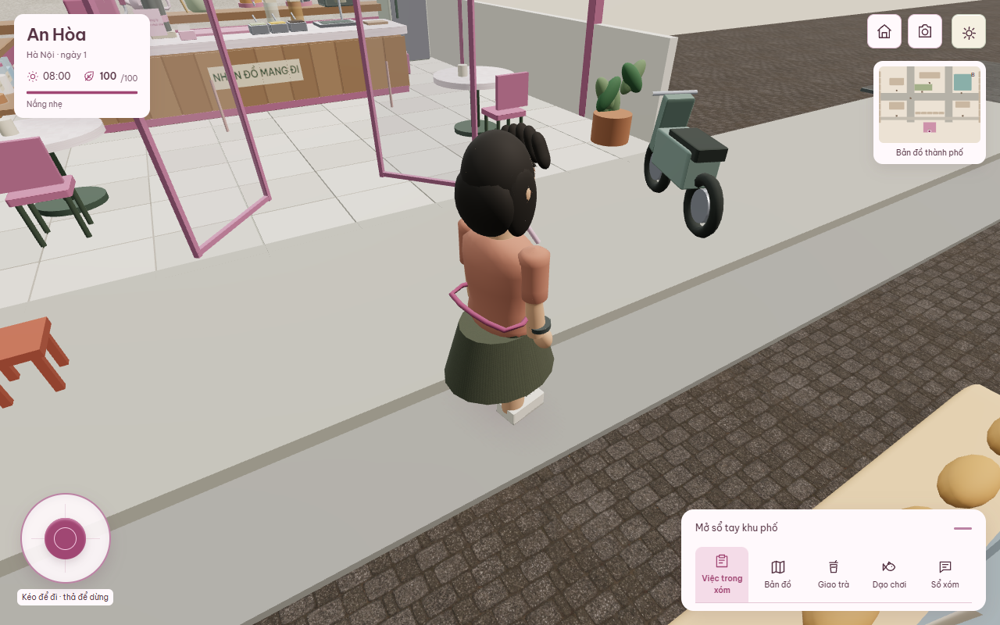
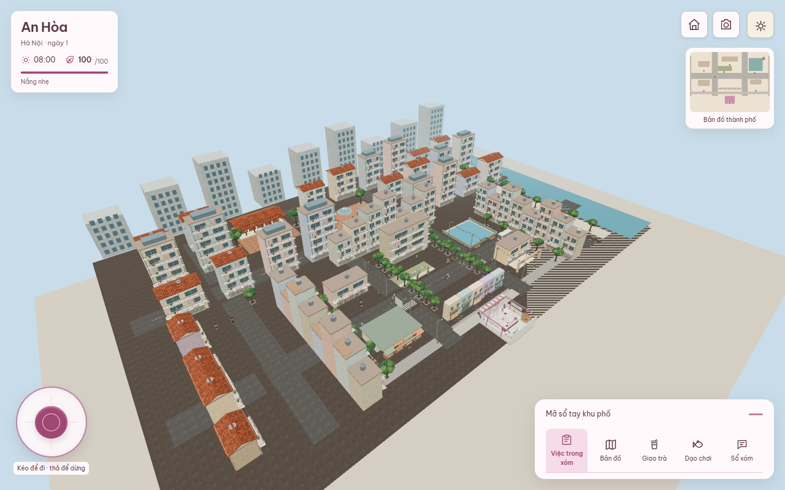

# Tích hợp Git và chạy thử — 16/10/2026

## Phạm vi

Nguồn: `origin/main` tại `36153f6` và toàn bộ đầu nhánh `origin` đã fetch ngày
16/10/2026. Nhánh thực hiện: `codex/integrate-game-20261016`.
Hợp nhất bằng merge commit, giữ lịch sử và không force push các nhánh AI.
Snapshot tích hợp đầu đưa 486 commit vào lịch sử kể từ main khởi đầu, gồm các
merge commit. Lần fetch cuối nhận thêm ba commit đến `6b81305` về hỏi lại góp ý
của khách quen; đã merge thêm và kiểm tra lại.
Các bản cũ của cùng một tính năng được đối chiếu với bản mới, không cộng dồn UI.
[Manifest 109 đầu nhánh](integration-20261016-branches.json): tất cả là ancestor
của bản tích hợp được kiểm tra; mỗi mục ghi nguyên SHA để truy vết.

## Những phần đang chạy trong app

- Buổi sáng: thức dậy, nấu ăn có hai bước, bánh mì hoặc bỏ bữa; giữ khóa mở tiệm
  đến khi lựa chọn bữa sáng hoàn tất.
- Gia đình, bạn bè, cô Thu, chăm cây, cơm hộp; các lựa chọn tồn tại đồng thời
  trong save v3. Cốt truyện các chương có nội dung đến ngày 51.
- Chợ hoa quả và chợ rau/nấu cơm dùng chung giới hạn một lượt chợ trong ngày.
  Nấu cơm cần đã mua rau; không thể lấy thưởng hoặc trả tiền lặp sau reload.
- Pha nhanh có đánh đổi điểm, rót thủ công, xử lý thiếu nguyên liệu, phản hồi
  khách quen, hệ quả pha lại, kế hoạch ca đông và dọn quầy cuối ngày.
- Hỏi kỹ góp ý của khách quen lưu lời giải thích vào nhật ký và hiển thị ở quầy
  sau reload; giữ nguyên đơn, thu thời gian/năng lượng đúng một lần.
- Animation giữ blend bước đi/ngồi, chớp mắt, ánh nhìn, tay bê ly và thêm chào
  hàng xóm. Sửa transform instancing để cập nhật cả cây cha trước khi batch.
- Chỉ một nút mở tiệm và một `RushShiftPanel` trong màn chuẩn bị.

## Giải quyết khác biệt giữa nhánh

Hợp nhất constructor/hydration và reducer riêng, bảo toàn tiền và bữa sáng đã trả.
Giữ triển khai hội thoại/ghi nhớ mới hơn khi nhánh cũ mang cùng chức năng.
Lan đi dạo thực tế là 15 phút; cập nhật chú thích UI cho khớp reducer.
Test cũ dùng ly mặc định đầy, bỏ qua bữa sáng hoặc yêu cầu đầu nhân vật đứng
yên tuyệt đối được sửa fixture theo luật hiện tại. Kiểm tra chào so với cùng
nhân vật ở idle, đảm bảo vẫn có chào một lần và không chào khi bê đồ.
Node test runner và Vitest được gọi riêng để tránh nhận nhầm suite.

## Nhánh Gemini cần đọc kỹ

`faca800` chỉ chứa installer đóng gói 42 tệp. Installer có lỗi cú pháp và patch
pose khác chữ ký đang dùng; các engine có state/NPC ID khác app hiện tại.
Đã phục hồi 41 tệp source/style/test vào
[`src/experimental/gemini`](../../src/experimental/gemini/README.md), sửa lỗi
kiểu/import và kiểm tra bằng TypeScript + unit tests. Chúng **chưa nối vào app**.
Không quảng cáo weather/mastery/ledger/animation prototype là gameplay đã hoạt động.
Installer gốc được giữ trong lịch sử; extractor hiện tại chỉ cho xuất vào staging
riêng và không patch animation. Payload workflow chạy AI mỗi giờ được giữ dưới
dạng dữ liệu, không kích hoạt automation ghi Git.

## Kiểm chứng

- `npm test`: 131 file Vitest, 637 test passed, không còn todo; Node acceptance gate 6/6;
  validator world/story dependency DAG passed.
- `npm run build`: TypeScript và Vite production passed. Cảnh báo chunk lớn còn
  tồn tại (Babylon khoảng 1,66 MB trước gzip); chưa đạt production budget mobile.
- `node --check` toàn bộ script `.mjs` và extractor passed; `git diff --check` passed.
- Chạy bản production tại `http://127.0.0.1:5188/`. Kiểm tra trực tiếp mua bánh mì,
  mua trái cây, reload còn 188.000 ₫, mở tiệm, dập nắp, bê ly, đến bàn và giao khách.
- [Mobile smoke](evidence/integration-20261016/mobile-results.json): 9 kích thước
  320×568 đến desktop, giữ canvas khi xoay, nhả joystick, sáng/cơm hộp/reload,
  dập nắp/bê ly/giao sau xoay và mở/đóng sổ khu phố; không pageerror.
- [Chợ và nấu cơm](evidence/integration-20261016/kitchen-results.json): 360×800,
  390×844, 844×390, 1280×800; mua rau/nấu/reload/mở tiệm passed cả bốn.
- [Cốt truyện trên trình duyệt](evidence/integration-20261016/story-results.json):
  12 kịch bản kiểm tra, gồm ngày 15 ở bốn màn hình và các tình huống mẫu ngày
  20–31, 40–41, 44–45. Dùng fixture để vào đúng ngày, rồi thao tác UI thật;
  kiểm tra tiền, kho, reload và lời nhắc tiếp nối. Không pageerror.
- Thay todo bằng hai test giao thật thường/cuối ca: giao sai chỗ hoặc chưa bê ly
  không trừ sức; giao thành công trừ đúng một lần và giữ tiền thưởng.
- Giới hạn Vitest bốn worker để không chạy quá nhiều tác vụ đồng thời trên máy
  đang render WebGL; không tăng timeout để bỏ qua test collision.
- Bằng chứng local đầy đủ ở `.impeccable/review/integration-20261016/` (ignored).
  Ảnh và kết quả chính đã commit bên cạnh tài liệu để AI khác đọc được.

## Giới hạn đã thấy

Buổi sáng sau khi ghép nhiều tính năng thành một danh sách rất dài. Cần một
luồng ưu tiên rõ ràng cho điện thoại; không nên thêm tiếp các modal prototype.
Nhiều chương có test reducer/UI nhưng chưa đi thủ công trọn 51 ngày.
Đồ họa vẫn là procedural stylized. Chưa có chứng cứ FPS/P95, nhiệt hoặc bộ nhớ
trên Android RAM 3–4 GB và iPhone thật; giả lập Chromium không thay thế việc đó.

## Cập nhật đồ họa và tích hợp buổi tối 16/10

Đã merge thêm `6fd2d9f` (ký ức khách quen, lời cảm ơn sau hỏi góp ý)
và `1558674` (lựa chọn ngày 12 mưa trước trường và hệ quả ngày sau).
Snapshot các đầu nhánh đã fetch đều là ancestor của `faf1a40`; manifest đã cập nhật.

- Khép đầu tay áo, đưa vai gần thân hơn, đồng bộ normal tại đường nối UV của
  các mesh tay/chân và thân áo. Giữ skin weights, khớp gối/khuỷu và carry grip.
- Đặt mắt, tai, miệng gần bề mặt đầu; tóc ôm đầu hơn, bỏ các sợi dạng dây nổi.
- Ánh sáng chân dung gần cảnh chơi hơn; nền gạch/vữa/gỗ của tiệm trung tính,
  giữ sắc hồng ở biển hiệu và mái hiên. Không thêm texture tải ngoài.
- Camera theo người kiểm tra toàn bộ đoạn nhìn qua footprint tòa nhà, thu gần
  trước vật cản. Có test tường ở giữa, cạnh song song, thứ tự nhiều vật cản.
- Sửa test thưởng ca đông: so cùng ly cuối ca và cùng ledger thay vì so fan
  giữa hai nhóm khách ngẫu nhiên khác nhau. CI cũ `d91aaef` đã lộ lỗi fixture này.
- Browser khách quen qua 4 kích thước: chào, hỏi góp ý, reload, giao ly thật,
  lưu phản hồi đúng và không nhân đôi chi phí. Kỳ vọng lời thoại cũ được sửa
  theo nhánh có hỏi kỹ góp ý; không nới điều kiện điểm hoặc bỏ bước giao ly.

`npm test`: 637 test/131 file + 6 node acceptance test; `npm run build`: thành công.
`visual-cohesion-smoke.mjs`: ảnh từ scene thật, dùng fixture vị trí/camera;
không được gọi đây là kiểm thử đi bộ bằng chạm hoặc số đo điện thoại thật.
Báo cáo khách quen: [JSON](evidence/integration-20261016/remembered-results.json).

Đồ họa vẫn là mô hình procedural cách điệu, chưa đạt chân thực. Cần một lượt
art pass với asset nhân vật rigged và bộ kiến trúc thống nhất; không tuyên bố
đã hoàn thiện production hoặc đạt FPS thiết bị cấu hình thấp qua SwiftShader.

Kiểm lại browser sau art pass: [mobile JSON](evidence/integration-20261016/mobile-latest-results.json),
9 kích thước quầy và 4 kích thước thành phố; không lỗi trang, giữ canvas khi
xoay, joystick được thả khi xoay, mua/nấu/reload và pha/giao ly thành công.
CI mã `faf1a40`: [build/test xanh](https://github.com/phung086/ban-tra-sua/actions/runs/38910174847).
Bổ sung sau kiểm tra: camera sát tường không bị khoảng cách tối thiểu đẩy xuyên
vật cản (test hồi quy riêng); 637 test tổng cộng. Prompt tiếp theo được chuyển
sang art pass nhân vật/mặt phố theo ưu tiên mới của người dùng.
