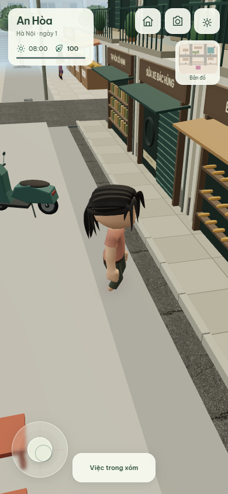
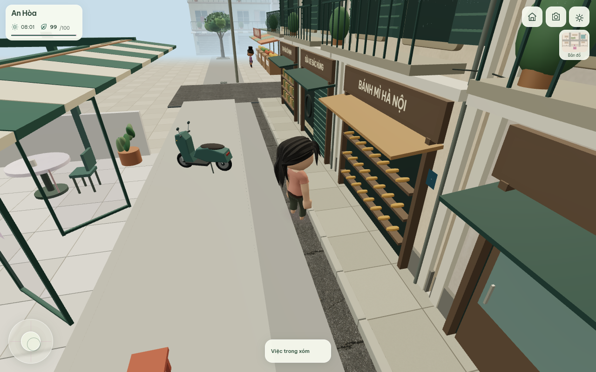
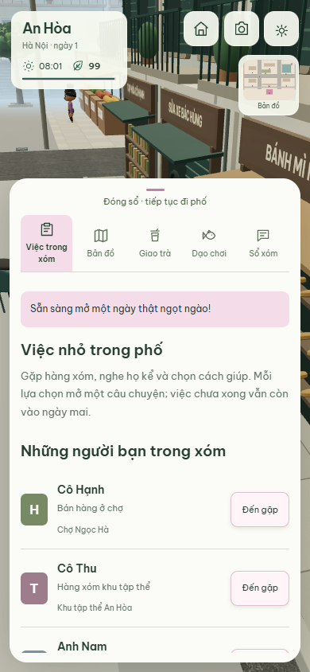
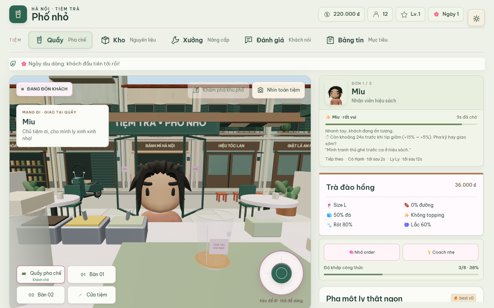

# Dựng lại trải nghiệm Phố Nhỏ — 18/10/2026

Nhánh `codex/rebuild-hanoi-experience-20261018`, tiếp nối `05364ad`.

## Đã triển khai trong runtime

- Thay người ghép capsule/box bằng ba model glTF có skin và skeleton, với
  palette riêng của khách. Model cũ chỉ còn làm fallback nếu tải asset lỗi.
  Idle, Walk, Walk_Carry, SitDown điều khiển bằng trạng thái thật của nhân vật.
- Dùng model đã áp dụng Idle để đo chiều cao, giữ chân ở mặt đường; làm mượt
  normal theo góc 60°. Chân dung và người trong cảnh dùng cùng model.
- Sửa cầu nối skeleton Three → Babylon để hỗ trợ thứ tự joint tùy ý trong glTF,
  giữ inverse bind và kiểm tra biến dạng trên dữ liệu model thật bằng NullEngine.
- Dựng lại mặt tiền 5 nhà An Hòa: cửa có chiều sâu, cửa chớp, ban công, mái,
  số nhà, bảng hiệu, kệ hàng; giữ footprint nền cho đường đi. Ban công/mái hiên
  có footprint camera riêng để người đi dưới mái được mà camera không xuyên.
- Thay xe máy hộp bằng thân đùn theo silhouette, yên, bánh/lốp, giảm xóc, gương,
  đèn, biển; dùng chung cho xe dựng trước tiệm và xe lưu thông.
- Đổi chất liệu nền phố sang gạch lát ô, vữa ít nhiễu, gỗ và xanh cửa thống nhất.
  Texture bề mặt được tạo/giải mã ở 256² thay cho 512² (1/4 pixel mỗi map);
  texture chữ giữ độ phân giải riêng. Không có texture lấy từ mạng khi chơi.
- Camera tìm góc orbit thông khi gặp tường và mái; vào chế độ mới căn góc ngay,
  sau đó hồi khoảng cách có easing. Đi phố về tiệm tiếp tục đến quầy và căn
  hướng nhìn về quầy khi kết thúc đường đi.
- HUD mới gọn, núm tròn 86–96px, nút chức năng 44px, minimap nhỏ; sổ nhiệm vụ
  đóng là một nút, mở mới hiển thị nội dung. Cảnh phố toàn màn hình cả desktop.
- Túi giao và vật mang theo cập nhật vị trí theo tay của rig mới.

## Nguồn tài sản

Quaternius, Ultimate Animated Character Pack. Giấy phép CC0 được lưu cùng
model tại `public/models/people/LICENSE.txt`; SHA-256 nguồn và bản đóng gói,
link nguồn và thay đổi được ghi trong `public/models/people/sources.json`.
Ba file tổng 1.993.188 byte, chỉ giữ bốn clip cần dùng và buffer còn tham chiếu.
Nguồn phát hành: https://quaternius.com/packs/ultimatedanimatedcharacter.html
Bản sao nguồn có license: https://github.com/MarcoPaoletta/4-xogot-reel-tycoon/tree/main/assets/Quaternius%20Ultimate%20Animated%20Characters

## Kiểm tra và giới hạn

`npm test`: 650 test / 134 file Vitest, node acceptance 6/6, life design validator.
`npm run build`: thành công. Babylon chunk vẫn có cảnh báo kích thước.
`checks/peopleAssets.test.ts` đọc GLB thật, kiểm chân trên mặt đường xuyên chu kỳ
Idle, chuyển clip, giải phóng skeleton và biến dạng giữa hai renderer.

Các bài browser dùng context riêng, không xóa save người dùng. Vị trí bắt đầu
và góc camera được chọn bằng fixture; kéo joystick, mở/đóng sổ và thao tác
buổi sáng/mở tiệm là sự kiện trình duyệt thật. SwiftShader/touch emulation
không phải bằng chứng hiệu năng điện thoại cấu hình thấp.

Đây là bản dựng lại nền hình ảnh và lớp tương tác, không phải mọi asset trong
thành phố đã đạt chất lượng cuối. Nhân vật vẫn cách điệu, chưa photorealistic.
Các nhà xa, cây và nội dung nhiệm vụ kế thừa hệ thống hiện tại; xe lưu thông
chưa có rider. Chưa đo FPS trên thiết bị thật hoặc nghiệm thu production.

Bước tiếp: dùng đúng bản này kiểm đi quanh một vòng An Hòa bằng ngón tay,
phục vụ 5 đơn và nhận/trả một nhiệm vụ; ghi vấn đề bằng ảnh/các bước tái hiện.
Ưu tiên lỗi góc camera, tư thế cầm/ngồi và kích thước đường trước khi thêm nội dung.

## Ảnh và browser evidence

- [Three browser](evidence/rebuild-hanoi-20261018/three-results.json): model,
  joystick/Walk, sổ tay, bốn viewport, buổi sáng và khách tới quầy.
- [Babylon browser](evidence/rebuild-hanoi-20261018/babylon-results.json): cùng
  rig/điều khiển, dọc/ngang, sổ tay và mở tiệm; không pageerror.
- [Lượt mobile đầu](evidence/rebuild-hanoi-20261018/mobile-first-pass.json):
  9 viewport quầy, 4 viewport phố (đóng/mở sổ), wake/bữa sáng/reload, pha/cầm/giao ly.
  Lượt này trước khi chốt đường trở lại quầy và specificity HUD ngang; xem
  báo cáo lần cuối khi có, không gán kết quả này cho toàn bộ thay đổi sau đó.

Lượt mobile chốt: [JSON](evidence/rebuild-hanoi-20261018/mobile-final-results.json)
qua 9 viewport quầy và 4 viewport phố (8 snapshot đóng/mở sổ), toàn bộ 6 luồng
wake/bữa sáng/reload, xoay và thả joystick, pha/cầm/giao ly; không pageerror.
Bản chốt này đã có footprint mái hiên, orbit an toàn, HUD ngang compact và
trở lại đúng quầy. Sau kiểm tra ảnh, thêm reset cuộn panel khi chuyển phase
để order không bị khuất sau luồng buổi sáng.
CI core `106bf6a`: https://github.com/phung086/ban-tra-sua/actions/runs/39134066228
Lan browser `106bf6a`: https://github.com/phung086/ban-tra-sua/actions/runs/39134066384

Sau sửa reset cuộn, `rebuild-browser-smoke` đã chạy lại trọn luồng, bao gồm
đợi đến đúng quầy, mở ca và assert scrollTop panel bằng 0; không pageerror.
[JSON mới nhất](evidence/rebuild-hanoi-20261018/three-results.json).

